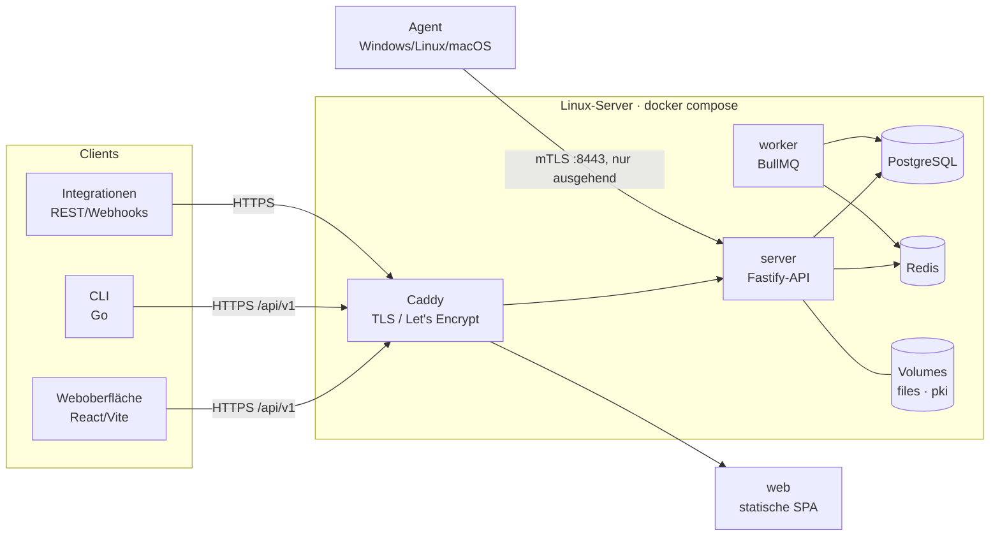

<p align="center">
  <a href="README.md"></a>
  <a href="README.de.md"></a>
</p>
<p align="center"><b>🌐 Sprache:</b> <a href="README.md">English</a> · <b>Deutsch</b></p>

<p align="center">
  <picture>
    <source media="(prefers-color-scheme: dark)" srcset="docs/images/logo-dark.svg">
    
  </picture>
</p>

<h1 align="center">OpenCM</h1>

<p align="center">
  <b>Freies, selbst gehostetes Client-Management für Windows, Linux und macOS.</b><br>
  Inventar · Skripte & Jobs · Schwachstellen · Sicherheitsstatus · Softwareverteilung · Patch-Management · Berichte
</p>

<p align="center">
  
  
  
  
</p>

---

## Was ist OpenCM?

OpenCM ist eine **Open-Source-Plattform für Client-Management**, die Sie auf Ihrem eigenen Server betreiben. IT-Administratoren sehen und steuern damit an einer Stelle alle Computer der Organisation:

- **Was ist vorhanden?** Hardware, Betriebssysteme, installierte Software, Benutzer und der Sicherheitsstatus jedes Geräts, dazu Geräte ohne Agent wie Monitore, Drucker und Telefone.
- **Wo ist ein Risiko?** Die installierte Software wird mit den Schwachstellen-Datenbanken NVD, CISA KEV und OSV abgeglichen. Fehlende Betriebssystem-Updates und schwache Sicherheitseinstellungen (z. B. BitLocker aus) werden gemeldet.
- **Was muss sich ändern?** Skripte, Softwarepakete und Updates werden stufenweise auf ausgewählte Geräte verteilt, mit Freigaben, Vier-Augen-Prinzip und Manipulationsschutz.

Auf jedem Gerät läuft ein kleiner Agent. Er baut ausschließlich **ausgehende** Verbindungen zum Server auf, verschlüsselt und gegenseitig authentifiziert (mTLS). Bedient wird alles über die **Weboberfläche**, das Kommandozeilenwerkzeug **`opencm`** oder die **REST-API**.

OpenCM ist **freie Software unter der MIT-Lizenz**. Es gibt keine Lizenzschlüssel und keine Begrenzung von Geräten, Benutzern oder Funktionen.

**[Bild: Dashboard – Übersichtskacheln (Geräte, Schwachstellen, Sicherheitsstatus, Updates) und Verlaufsdiagramme]**

---

## Inhaltsverzeichnis

1. [Auf einen Blick](#auf-einen-blick)
2. [Screenshots](#screenshots)
3. [Funktionen im Detail](#funktionen-im-detail)
   - [Inventar](#inventar)
   - [Assets ohne Agent](#assets-ohne-agent)
   - [Skripte & Jobs](#skripte--jobs)
   - [Schwachstellen](#schwachstellen)
   - [Sicherheitsstatus](#sicherheitsstatus)
   - [Softwareverteilung](#softwareverteilung)
   - [Patch-Management](#patch-management)
   - [Dashboard & Berichte](#dashboard--berichte)
   - [Webhooks](#webhooks)
   - [Softwarelizenzen](#softwarelizenzen)
   - [Benutzer, Rollen & Anmeldung](#benutzer-rollen--anmeldung)
   - [Manipulationsschutz](#manipulationsschutz)
4. [Architektur](#architektur)
5. [Installation](#installation)
6. [Geräte aufnehmen](#geräte-aufnehmen)
7. [Kommandozeile (CLI)](#kommandozeile-cli)
8. [REST-API](#rest-api)
9. [Konfiguration](#konfiguration)
10. [Sicherheit](#sicherheit)
11. [Backup, Wiederherstellung & Updates](#backup-wiederherstellung--updates)
12. [Entwicklung](#entwicklung)
13. [Projektstand & Ausblick](#projektstand--ausblick)
14. [Weitere Dokumentation](#weitere-dokumentation)
15. [Lizenz](#lizenz)

---

## Auf einen Blick

| | |
|---|---|
| 🖥️ **Agent für alle Plattformen** | Ein Agent (Go) für Windows, Linux und macOS als Dienst, nur ausgehendes mTLS, signiertes Selbstupdate |
| 📋 **Vollständiges Inventar** | Hardware, Betriebssystem, Software, Dienste, Benutzer, Patches, Änderungshistorie, eigene Felder, dazu Assets ohne Agent |
| ⚙️ **Automatisierung** | Skript-Bibliothek mit Versionen und Freigabe, Jobs mit Zeitplänen, Wartungsfenstern, Wiederholungen und Live-Ausgabe |
| 🛡️ **Schwachstellen** | NVD-Spiegel, CISA KEV, FIRST EPSS, OSV für Linux-Distributionen, Behebungs-Job direkt aus der CVE |
| 🔒 **Sicherheitsstatus** | BitLocker / FileVault / LUKS, Defender und andere Virenschutzprodukte, Firewall, Secure Boot, TPM, mit Konformitätsbewertung |
| 📦 **Software & Patches** | Paket-Repository, stufenweise Verteilung in Ringen, Bandbreitenbegrenzung, Windows Update / apt / dnf / softwareupdate |
| 📊 **Berichte** | Dashboard mit Trends, Bericht-Editor über 8 Datenquellen, CSV-Export |
| 🔔 **Integration** | Signierte Webhooks, vollständige REST-API (OpenAPI 3.1), CLI für jedes Modul |
| 👥 **Zugriffskontrolle** | Feingranulare Rollen, Beschränkung auf Gerätegruppen, Vier-Augen-Freigaben, MFA, API-Tokens, LDAP / Active Directory |
| 🔐 **Manipulationsschutz** | SHA-256 + HMAC-Siegel für jedes Skript und jede Datei, auf dem Gerät vor der Ausführung erneut geprüft |

---

## Screenshots

**[Bild: Geräteliste – Suche, Betriebssystem-Filter, Online-Status]**

**[Bild: Gerätedetail – Reiter Übersicht, Sicherheit, Schwachstellen, Updates, Software, Historie]**

**[Bild: Skript-Editor mit Syntax-Hervorhebung, Parametern und Testlauf auf einem Gerät]**

**[Bild: Ausführung – Live-Ausgabe (stdout/stderr) und Exitcode je Gerät]**

**[Bild: Schwachstellen – nach Risiko sortierte CVE-Liste mit Schweregrad, KEV-Markierung und EPSS]**

**[Bild: Sicherheitsstatus – Kacheln „nicht konform / unverschlüsselt / Virenschutz-Probleme“ und Gerätetabelle]**

**[Bild: Softwareverteilung – Verteilung in Ringen (Test → Pilot → Alle) mit Fortschrittsbalken]**

**[Bild: Bericht-Editor – Spalten wählen, Filter setzen, Live-Vorschau]**

**[Bild: Assets – Liste von Monitoren und Druckern mit Garantie-Kennzeichnung, CSV-Import-Dialog]**

---

## Funktionen im Detail

### Inventar

Der Agent erfasst alle 24 Stunden, oder sofort auf Anforderung, ein vollständiges Inventar:

| Bereich | Windows | Linux | macOS |
|---|---|---|---|
| Hardware, BIOS, Seriennummer | CIM | `/sys/class/dmi`, `/proc` | `system_profiler` |
| Betriebssystem | CIM + Registry (Build, UBR) | `/etc/os-release`, Kernel | `system_profiler`, `sysctl` |
| Software | Uninstall-Schlüssel (64/32 Bit), MSI, MSIX/Store | dpkg, rpm (inkl. Quellpaket) | Programme |
| Patches | installierte Hotfixes | über den Patch-Scan | `softwareupdate --history` |
| Dienste, Autostart | Dienste, Autostart-Befehle | systemd, XDG-Autostart | launchd |
| Benutzer & Gruppen, angemeldete Benutzer | CIM + ADSI | `/etc/passwd`, `/etc/group`, `who` | `dscl`, Konsolenbenutzer |
| Netzwerk, Datenträger | ✔ | ✔ | ✔ |
| Sicherheitsstatus | BitLocker, Defender, Firewall, Secure Boot, TPM | LUKS, ufw/firewalld/nftables, Secure Boot, TPM, ClamAV/Defender | FileVault, Firewall, XProtect/Gatekeeper |

- **Änderungshistorie:** Jede Änderung an Hardware, Betriebssystem, Software, Patches, Diensten, Benutzern, Gruppen und Sicherheitseinstellungen wird je Gerät festgehalten. Flüchtige Werte wie freier Speicher oder IP-Adressen werden nicht protokolliert.
- **Eigene Felder:** Text, Zahl, Ja/Nein oder Datum. Sie werden von Hand oder automatisch über ein Skript in einem Job befüllt.
- **Dynamische Gerätegruppen:** Gruppen entstehen aus Filtern auf Gerätefelder, Online-Status, installierte Software, eigene Felder oder den Sicherheitsstatus (z. B. *„alle Notebooks ohne BitLocker“*), mit Live-Vorschau.

**[Bild: Filter-Baukasten für dynamische Gruppen mit Bedingungen und Vorschau der passenden Geräte]**

### Assets ohne Agent

Monitore, Drucker, Telefone, Netzwerkgeräte, Dockingstationen und Geräte im Lager lassen sich ohne Agent erfassen.

- **Felder:** Typ, Status (Lager, in Benutzung, Reparatur, ausgemustert), Hersteller, Modell, Seriennummer, eindeutige Inventarnummer, Standort, zugeordnete Person, IP/MAC, Kaufdatum, Garantieende, Kosten und Notizen.
- **Zuordnung:** Ein Asset kann einem verwalteten Gerät zugeordnet werden und erscheint dann dort im Reiter *Zubehör* (z. B. die Monitore eines PCs).
- **CSV-Import** im Excel-Format (`;` oder `,`, deutsche oder englische Spaltennamen):
  - Ein Probelauf zeigt, was sich ändern würde, bevor etwas gespeichert wird.
  - Vorhandene Assets werden über die Inventarnummer erkannt, sonst über die Seriennummer.
- **CSV-Export** im gleichen Format, die Datei lässt sich also wieder einlesen.
- **Garantie-Übersicht:** Filter für Garantien, die in 30/90 Tagen enden, eine Dashboard-Kachel und eine Berichtsquelle.

### Skripte & Jobs

- **Skript-Bibliothek:**
  - Sprachen: PowerShell, CMD, Bash, zsh und Python.
  - Jede Änderung erzeugt eine neue, **unveränderliche Version**. Eine Version durchläuft Entwurf, freigegeben und zurückgezogen; ausführen lassen sich nur freigegebene Versionen.
  - Parameter kommen als Umgebungsvariablen `OPENCM_PARAM_<NAME>` im Skript an.
  - Editor mit Syntax-Hervorhebung (CodeMirror), Vorlagen (winget, Chocolatey, apt, dnf, macOS-Updates …) und **Testlauf auf einem einzelnen Gerät** (Entwürfe kann nur testen, wer Skripte auch freigeben darf).
- **Jobs:**
  - Ein Job verbindet einen oder mehrere Schritte mit Zielen (Geräte, statische oder dynamische Gruppen, alle Geräte).
  - **Auslöser:** sofort, einmalig, Cron (mit Zeitzone), Agent-Start oder Benutzeranmeldung.
  - **Optionen:** Wartungsfenster, Wiederholungen, Zeitlimit und „bei Fehler weitermachen“ je Schritt.
- **Live-Ausgabe:**
  - stdout, stderr und Exitcode je Gerät, übertragen, während das Skript läuft.
  - Ausführungen lassen sich abbrechen, auch laufende Tasks.
  - Fehlgeschlagene Geräte lassen sich erneut ausführen.
- **Signierte Aufträge:** Jeder Auftrag ist mit Ed25519 signiert. Der Agent lehnt alles Unsignierte oder Veränderte ab.

**[Bild: Job-Editor – Schritte, Ziele, Zeitplan und Wartungsfenster]**

### Schwachstellen

- **Quellen:**
  - **NVD** (vollständiger Spiegel; setzt nach einer Unterbrechung an derselben Stelle fort und wird danach inkrementell aktuell gehalten).
  - **CISA KEV**: aktiv ausgenutzte Schwachstellen, inkl. CISA-Frist.
  - **FIRST EPSS**: Wahrscheinlichkeit, dass eine Schwachstelle ausgenutzt wird.
  - **OSV**: Sicherheitsmeldungen der Linux-Distributionen.
- **Zuordnung der installierten Software zu CPEs:**
  - Rund 60 mitgelieferte Regeln, eigene Glob-Regeln und eine Heuristik.
  - Vorschläge für Software, die sich nicht zuordnen ließ.
- **Linux-Distributionen (OSV):**
  - Deckt Pakete von Debian, Ubuntu, Rocky Linux und AlmaLinux ab, geprüft über Quellpaket und exakte Version.
  - Zurückportierte Fixes werden erkannt; ein gepatchtes `openssl 3.0.2` unter Ubuntu wird also nicht gemeldet.
  - An osv.dev gehen nur Paketnamen und Versionen, nie Hostnamen.
- **Befunde:**
  - Nach Risiko sortiert (KEV, CVSS, EPSS), mit Konfidenzstufen und der Liste betroffener Geräte.
  - **Risikoakzeptanz** braucht eine Pflicht-Begründung und wird im Audit-Log festgehalten.
- **Behebung:** Aus einer CVE wird direkt ein Job für alle betroffenen Geräte erzeugt, auf Wunsch sofort ausgeführt.
- **Benachrichtigung** über neue kritische oder aktiv ausgenutzte Befunde per Webhook.

**[Bild: CVE-Detailseite – Beschreibung, CVSS, KEV-Frist, betroffene Geräte und Schaltfläche „Behebungs-Job erstellen“]**

### Sicherheitsstatus

Jedes Inventar enthält den Sicherheitsstatus des Geräts. Die Abfragen sind rein lesend.

| | Windows | macOS | Linux |
|---|---|---|---|
| Laufwerksverschlüsselung | BitLocker je Laufwerk (inkl. „angehalten“) | FileVault | LUKS / dm-crypt |
| Virenschutz | Microsoft Defender + Fremdprodukte aus dem Sicherheitscenter | XProtect + Gatekeeper | Defender for Endpoint, ClamAV (optional) |
| Firewall | Profile Domäne / Privat / Öffentlich | Programm-Firewall | ufw, firewalld, nftables |
| Plattform | Secure Boot, TPM | – | Secure Boot, TPM |

- **Konformitätsregel:** Ein Gerät ist *konform*, wenn seine Laufwerke verschlüsselt sind, die Firewall an ist und unter Windows und macOS ein aktueller Virenschutz mit Echtzeitschutz läuft.
- **Probleme** haben klare Bezeichnungen, z. B. *„Systemlaufwerk nicht verschlüsselt“* oder *„Virensignaturen veraltet“*. Sie lassen sich filtern und als CSV exportieren.
- **Webhook** `device.security_changed`: wird ausgelöst, wenn sich der Status eines Geräts verschlechtert.
- **Wo es auftaucht:** Dashboard-Kachel, Trends, Filter für dynamische Gruppen und die Berichtsquelle *Sicherheitsstatus*.

### Softwareverteilung

- **Paket-Repository** mit 11 Typen: MSI, EXE, winget, Chocolatey, DEB, RPM, apt, dnf, PKG, Homebrew und eigene Befehle.
- **Installationsdateien:**
  - Uploads werden gestreamt, über SHA-256 dedupliziert und in der Größe begrenzt.
  - Agents laden über mTLS; abgebrochene Downloads werden fortgesetzt (Range).
- **Erkennungsregeln** entscheiden, ob ein Paket schon installiert ist bzw. die Installation geklappt hat: Software mit Version, Datei, Registry-Wert oder ein Befehl. Sie werden vor und nach der Installation geprüft.
- **Exitcodes:** Sie legen fest, welche Codes als Erfolg und welche als „Neustart nötig“ gelten.
- **Versionen mit Freigabe** (optional Vier-Augen); eine freigegebene Version lässt sich nicht mehr ändern (von der Datenbank erzwungen).
- **Verteilung in Ringen** (z. B. Test → Pilot → Alle):
  - Der nächste Ring startet automatisch nach einer Wartezeit und einer Mindest-Erfolgsquote.
  - Ein Ring pausiert automatisch, wenn zu viele Geräte scheitern; er lässt sich fortsetzen oder abbrechen.
- **Bandbreitenbegrenzung** für den ganzen Server und je Gerät.
- **Installationsstand:** zeigt aus dem Inventar, auf welchen Geräten welche Version installiert ist.

**[Bild: Paketdetail – Versionen, Erkennungsregeln, Vorschau des erzeugten Skripts und Verteilungsformular]**

### Patch-Management

- **Scans:**
  - Ausstehende Updates werden mit Windows Update Agent (auch über WSUS), apt, dnf/yum und softwareupdate ermittelt.
  - Scans laufen automatisch (z. B. alle 24 h) oder manuell.
- **Installation:**
  - Updates werden nach Klassifikation (z. B. nur Sicherheitsupdates) oder einzeln ausgewählt und in Ringen verteilt.
  - Eine Neustart-Richtlinie greift, und nach der Installation läuft ein neuer Scan.
- **Übersichten** je Gerät und je Update, inkl. fehlender Sicherheitsupdates und ausstehender Neustarts, als CSV exportierbar.

**[Bild: Patch-Übersicht – Geräte mit fehlenden Sicherheitsupdates und ausstehenden Neustarts]**

### Dashboard & Berichte

- **Dashboard:**
  - Kennzahlen je Bereich: Geräte, Schwachstellen, Sicherheitsstatus, Updates, fehlgeschlagene Tasks, Verteilungen, Freigaben, Lizenzen und Assets.
  - Was angezeigt wird, hängt von Ihren Rechten und Ihrem Geräte-Geltungsbereich ab.
- **Trends** über 30, 90 oder 365 Tage. Der Worker speichert die Werte stündlich.
- **Bericht-Editor** mit 8 Datenquellen: Geräte, Software, Schwachstellen-Befunde, ausstehende Updates, Task-Ergebnisse, Softwarelizenzen, Sicherheitsstatus und Assets.
  - Spalten wählen, mit 11 Operatoren filtern und sortieren; eine Live-Vorschau zeigt das Ergebnis.
  - Berichte können privat sein oder mit anderen geteilt werden.
  - Export als CSV für Excel oder als JSON, bis 100.000 Zeilen.

### Webhooks

Webhooks schicken signierte Benachrichtigungen an andere Systeme, etwa ein Ticketsystem, einen Chat oder ein SIEM.

| Ereignis | Wann |
|---|---|
| `device.enrolled` | ein neues Gerät wurde registriert |
| `run.completed` / `task.failed` | eine Ausführung ist beendet / ein Task ist endgültig fehlgeschlagen |
| `deployment.completed` / `deployment.paused` | eine Verteilung ist fertig / wurde angehalten |
| `approval.requested` | eine Vier-Augen-Freigabe wird benötigt |
| `vulnerability.findings.new` | neue kritische oder aktiv ausgenutzte Befunde |
| `patch.scan_failed` | ein Patch-Scan ist fehlgeschlagen |
| `security.integrity_violation` | eine Hash-Prüfung ist fehlgeschlagen (Manipulationsverdacht) |
| `license.overused` | mehr Installationen als Lizenzen |
| `device.security_changed` | der Sicherheitsstatus eines Geräts hat sich verschlechtert |

- **Signatur:** `X-OpenCM-Signature: sha256=HMAC(Geheimnis, Zeitstempel + "." + Body)`.
- **Zustellung:** Wiederholungen nach 1 min, 5 min, 30 min, 2 h und 6 h, mit Zustellprotokoll und „erneut senden“.
- **Schutz:** Link-Local- und Cloud-Metadaten-Adressen werden als Ziel abgewiesen, auch wenn ein Hostname dorthin auflöst.

### Softwarelizenzen

Dieses Modul verwaltet die Lizenzen, die Ihre Organisation für **Fremdsoftware** besitzt (z. B. Office-Pakete).

- Software-Muster werden mit dem Inventar abgeglichen und zeigen genutzte, freie und **überschrittene** Lizenzen.
- Bald ablaufende Verträge werden markiert, Kosten lassen sich erfassen.
- Eine Überschreitung löst den Webhook `license.overused` aus.

> Das hat nichts mit der Lizenz von OpenCM zu tun: OpenCM steht unter MIT-Lizenz und ist unbeschränkt nutzbar.

### Benutzer, Rollen & Anmeldung

- **Rollen** mit feingranularen Rechten je Modul und Aktion (`devices:read`, `jobs:execute`, `software:approve` …), dazu die Systemrollen Administrator, Auditor und Helpdesk.
- **Geltungsbereiche:** Eine Rolle lässt sich auf Gerätegruppen beschränken, z. B. „Helpdesk München sieht nur die Münchner Geräte“. Geräte außerhalb bleiben unsichtbar (die API antwortet mit 404).
- **Vier-Augen-Freigabe:**
  - Nötig für Massenaktionen (alle Geräte oder mehr als ein Schwellwert), für das Aktivieren breiter Zeitpläne und für Verteilungen.
  - Die eigene Anfrage lässt sich nicht selbst freigeben.
- **MFA (TOTP):** Einrichtung per QR-Code; 10 Wiederherstellungscodes; kann verpflichtend gemacht werden; Admins können sie zurücksetzen.
- **API-Tokens:** Ein Token hat nie mehr Rechte als sein Besitzer, hat eine maximale Laufzeit und lässt sich widerrufen.
- **LDAP / Active Directory:** Anmeldung mit verschachtelten AD-Gruppen, die OpenCM-Gruppen zugeordnet werden; das Benutzerkonto wird bei der ersten Anmeldung automatisch angelegt.
- **Audit-Log:** Jede schreibende Aktion wird protokolliert. Das Log lässt sich nur ergänzen, nicht ändern (per Datenbank-Trigger erzwungen), und als CSV oder JSON exportieren.

**[Bild: Rollen-Editor – Rechte-Matrix je Modul und Aktion]**

### Manipulationsschutz

Alles, was auf einem Gerät ausgeführt wird, erhält beim Speichern einen **SHA-256-Hash**: Skriptversionen, Installationsdateien und die für Pakete und Patches erzeugten Schritte. Der Hash wird mehrfach 1:1 verglichen:

| Wann | Prüfung |
|---|---|
| Ausführung anlegen | Inhalt ↔ gespeicherter Hash ↔ Quelle (freigegebene Version) ↔ HMAC-Siegel |
| Auslieferung an das Gerät | dieselbe Prüfung noch einmal; der Auftrag wird mit Ed25519 signiert |
| Paket freigeben / Ring starten | die Installationsdatei im Repository wird neu gehasht |
| Auf dem Gerät | Signatur, Hash jedes Schritts, der heruntergeladenen Datei und der Skriptdatei auf dem Datenträger direkt vor dem Start |

Stimmt etwas nicht, wird **nichts ausgeführt**:

- Der Task endet mit *„Hash-Prüfung fehlgeschlagen“*.
- Verteilungen pausieren.
- Ein Audit-Eintrag `security.integrity_violation` wird geschrieben, und der gleichnamige Webhook wird ausgelöst.

Der Schlüssel für das Siegel liegt außerhalb der Datenbank. Selbst wer Schreibzugriff auf die Datenbank hat, kann deshalb keinen passenden Hash fälschen.

---

## Architektur



| Komponente | Technik | Aufgabe |
|---|---|---|
| **server** | Node.js ≥ 24, TypeScript, Fastify 5, Drizzle ORM | REST-API `/api/v1`, Anmeldung, Rechte, Audit, mTLS-Endpoint für Agents; führt beim Start die DB-Migrationen aus |
| **worker** | BullMQ / Redis | Hintergrundarbeit: Job-Verteilung, Zeitpläne, Feed-Abgleich (NVD, KEV, EPSS, OSV), Verteilungen, Patch-Scans, Webhooks, Kennzahlen |
| **web** | React 18 + Vite + TypeScript | Weboberfläche; spricht nur die öffentliche API |
| **proxy** | Caddy | TLS mit Let's Encrypt, Weiterleitung |
| **Datenbank** | PostgreSQL 16 | Alle Daten; Migrationen sind versioniert |
| **cli** | Go, Cobra | `opencm` – mehrere Server-Profile, Ausgabe als Tabelle/JSON/YAML, Shell-Vervollständigung |
| **agent** | Go | `opencm-agent` – Dienst unter Windows, systemd, launchd |

**[Bild: Architekturdiagramm (gerendert)]**

---

## Installation

**Voraussetzungen:** ein Linux-Server mit Docker und Docker Compose, ein DNS-Name sowie freigegebene Ports **443/80** (Web) und **8443** (Agents).

```bash
git clone <repository-url> opencm
cd opencm/deploy
cp .env.example .env
# .env anpassen: OPENCM_DOMAIN, ACME_EMAIL, POSTGRES_PASSWORD, BOOTSTRAP_ADMIN_PASSWORD
docker compose up -d --build
```

Danach `https://<OPENCM_DOMAIN>` öffnen und mit dem Bootstrap-Admin anmelden. Die interaktive API-Doku liegt unter `/api/docs`.

| Port | Dienst | Hinweis |
|---|---|---|
| 443 / 80 | Caddy → Weboberfläche + REST-API | Let's-Encrypt-Zertifikat wird automatisch geholt |
| 8443 | Agent-Endpoint (mTLS) | Wird direkt vom Server-Container veröffentlicht. TLS muss im Server enden, weil ein vorgeschalteter TLS-Proxy das Client-Zertifikat verlieren würde. |

> **Tipp:** `BOOTSTRAP_ADMIN_PASSWORD` nach dem ersten Start aus der `.env` entfernen und für das Admin-Konto MFA einrichten.

---

## Geräte aufnehmen

1. In der Weboberfläche **Geräte → Geräte hinzufügen** öffnen und ein Registrierungs-Token erstellen (Gültigkeit, maximale Anzahl Geräte, optional Zielgruppe).
2. Den angezeigten Befehl auf dem Gerät ausführen: unter Windows in einer PowerShell als Administrator, unter Linux und macOS als root. Er lädt den Agent, registriert ihn und installiert den Dienst.
3. Das Gerät erscheint nach wenigen Sekunden; das erste Inventar folgt mit dem ersten Heartbeat.

**[Bild: Seite „Geräte hinzufügen“ mit Token und kopierfertigen Installationsbefehlen für Windows, Linux und macOS]**

Manuelle Befehle:

```text
opencm-agent enroll --server https://cm.example.org --token oce_…   [--ca-file interne-ca.pem]
opencm-agent install
opencm-agent status        # Geräte-ID, Endpoint, Zertifikatsablauf
opencm-agent inventory     # lokales Inventar als JSON ansehen (sendet nichts)
opencm-agent uninstall
```

| OS | Programm | Konfiguration / Daten | Dienst | Log |
|---|---|---|---|---|
| Windows | `C:\Program Files\OpenCM\opencm-agent.exe` | `C:\ProgramData\OpenCM\` | `OpenCMAgent` | `C:\ProgramData\OpenCM\logs\agent.log` |
| Linux | `/usr/local/bin/opencm-agent` | `/etc/opencm/`, `/var/lib/opencm/` | systemd `opencm-agent` | `journalctl -u opencm-agent` |
| macOS | `/usr/local/bin/opencm-agent` | `/Library/Application Support/OpenCM/` | launchd `org.opencm.agent` | `/Library/Logs/OpenCM/agent.log` |

**Verhalten des Agents:**

- **Heartbeat:** alle 60 s. Ein Gerät gilt als online, wenn es sich innerhalb von 3 Intervallen gemeldet hat.
- **Inventar:** alle 24 h oder sofort auf Anforderung.
- **Verbindungsfehler:** Der Agent versucht es mit wachsendem Abstand erneut, bis zu 15 min zwischen zwei Versuchen.
- **Client-Zertifikat:** wird vor Ablauf automatisch erneuert.
- **Widerruf** wirkt sofort.

---

## Kommandozeile (CLI)

Die CLI `opencm` deckt jedes Modul ab und nutzt dieselbe API wie die Weboberfläche.

```bash
opencm login --server https://cm.example.org -u admin --otp 123456
opencm devices list --filter "os=windows,online=true"
opencm enrollment-tokens create --name "Rollout" --max-uses 25 --os windows

# Skripte & Jobs
opencm scripts run <skript-id> --target group:Buchhaltung --param Days=7 --watch
opencm jobs status <run-id> --watch
opencm tasks output <task-id> --follow

# Schwachstellen
opencm cve list --severity critical
opencm cve remediate CVE-2024-1234 --script <id> --param PackageId=Mozilla.Firefox --run

# Software & Patches
opencm packages create "7-Zip" --platform windows
opencm packages add-version 7-Zip 24.08 --type msi --detect-software "7-Zip*>=24.08"
opencm packages upload 7-Zip 24.08 ./7z2408-x64.msi && opencm packages approve 7-Zip 24.08
opencm deploy 7-Zip --ring Test=group:IT --ring Alle=all --delay 24
opencm patches install --classification security --ring Test=group:IT --ring Alle=all

# Sicherheitsstatus & Assets
opencm security status --compliant no
opencm assets import inventar.csv --dry-run && opencm assets import inventar.csv
opencm assets list --warranty-days 30

# Berichte, Webhooks, Verwaltung
opencm dashboard
opencm reports query software --filter "name contains firefox" --filter "version lt 130"
opencm webhooks create Ticketsystem https://tickets.example.org/hooks/opencm --event security.integrity_violation
opencm tokens create ci --permission devices:read --days 30
opencm approvals list && opencm approvals approve <id>
opencm audit export --format csv -f audit.csv
opencm completion powershell | Out-String | Invoke-Expression
```

- Ausgabe als Tabelle (Standard) oder mit `-o json|yaml` für Skripte.
- Mehrere Server werden als Profile verwaltet (`--profile`).
- **Exitcodes:** 0 OK · 1 Fehler · 2 Aufruf · 3 nicht angemeldet · 4 keine Berechtigung · 5 nicht gefunden · 6 Konflikt · 7 Ausführung fehlgeschlagen (`--watch`) · 8 wartet auf Freigabe.

---

## REST-API

- **OpenAPI 3.1** ist die einzige Quelle der Wahrheit: `server/openapi.yaml`, interaktiv unter `/api/docs`.
- Ein Contract-Test stellt sicher, dass jede Route dokumentiert ist und jede dokumentierte Operation existiert.
- **Anmeldung:** Session-Token (`Authorization: Bearer …`) oder API-Token. Im Browser wird ein httpOnly-Cookie verwendet.
- **Rechte:** Jede Operation nennt in `x-permission` das Recht, das sie braucht.
- **Fehler** haben immer die Form `{ "error": { "code", "message", "details?" } }`.

```bash
curl -H "Authorization: Bearer $OPENCM_TOKEN" https://cm.example.org/api/v1/security-status?compliant=false
```

---

## Konfiguration

Alle Einstellungen sind Umgebungsvariablen in `deploy/.env`; `deploy/.env.example` beschreibt jede einzelne. Die wichtigsten:

| Variable | Standard | Bedeutung |
|---|---|---|
| `OPENCM_DOMAIN`, `ACME_EMAIL` | – | Öffentlicher Hostname und E-Mail für Let's Encrypt |
| `POSTGRES_PASSWORD` | – | Datenbank-Passwort |
| `BOOTSTRAP_ADMIN_USER` / `_PASSWORD` | – | Erster Admin (nur beim ersten Start) |
| `AGENT_HEARTBEAT_SECONDS` | `60` | Meldeintervall der Agents |
| `FOUR_EYES_ENABLED`, `FOUR_EYES_DEVICE_THRESHOLD` | `true`, `50` | Vier-Augen-Freigabe für Massenaktionen |
| `MFA_REQUIRED` | `false` | MFA für alle verpflichtend |
| `LDAP_URL`, `LDAP_BIND_DN`, `LDAP_BASE_DN` … | – | Anmeldung über LDAP / Active Directory |
| `VULN_FEEDS_ENABLED`, `NVD_API_KEY` | `true`, – | Schwachstellen-Feeds; ein (kostenloser) NVD-Schlüssel beschleunigt den ersten Spiegel |
| `OSV_ENABLED` | `true` | OSV-Abgleich für Linux-Distributionspakete |
| `SECURITY_AV_MAX_AGE_DAYS` | `3` | Ab diesem Alter gelten Virensignaturen als veraltet |
| `PACKAGE_MAX_BYTES`, `PACKAGE_BANDWIDTH_KBPS` | 4 GiB, `0` | Upload-Limit, Download-Bandbreite (0 = unbegrenzt) |
| `PATCH_SCAN_INTERVAL_HOURS` | `24` | Automatischer Patch-Scan |
| `WEBHOOK_ALLOW_HTTP` | `false` | Webhook-Ziele mit einfachem http erlauben |

> **Netze ohne Internet:** `VULN_FEEDS_ENABLED=false` setzen. Für einen HTTP-Proxy `NODE_USE_ENV_PROXY=1` und `HTTPS_PROXY=…` verwenden.

---

## Sicherheit

- **Agents:**
  - Verbindungen laufen über mTLS mit OpenCMs eigener CA (ECDSA P-256), und der Agent verbindet sich nur nach außen.
  - Aufträge sind mit Ed25519 signiert, Agent-Updates ebenso.
- **Manipulationsschutz:** SHA-256 plus HMAC-Siegel für alles, was ausgeführt wird (siehe [Manipulationsschutz](#manipulationsschutz)).
- **Passwörter und Tokens:** Passwörter werden mit Argon2id gehasht. Session- und API-Tokens liegen nur als SHA-256-Hash vor. MFA-Geheimnisse sind mit AES-256-GCM verschlüsselt.
- **Minimale Rechte:** Rechte je Modul und Aktion, Geltungsbereiche auf Gerätegruppen und Vier-Augen-Freigaben.
- **Audit:** ein Audit-Log, das sich nur ergänzen lässt, mit Export.
- **Kein SQL vom Client:** Berichtsfilter werden aus festen Listen zusammengesetzt, und Werte werden als Parameter übergeben.
- **Datenschutz:** OSV erhält nur Paketnamen und Versionen. Es werden keine Telemetriedaten an irgendjemanden gesendet.

> **Wichtige Geheimnisse** liegen im Volume `pki`: `ca.key` (Agent-CA), `integrity.key` (Siegel-Schlüssel) und `secrets.key` (Verschlüsselung). Sie gehören zum Backup, deshalb **Backups verschlüsselt aufbewahren**.

---

## Backup, Wiederherstellung & Updates

```bash
deploy/backup.sh                 # Datenbank-Dump + Volumes "files" und "pki"
deploy/restore.sh <verzeichnis> --yes    # Wiederherstellung
docker compose pull && docker compose up -d   # Update; Migrationen laufen automatisch
```

---

## Entwicklung

Voraussetzungen: Node.js ≥ 24 und Go 1.23 für CLI und Agent. Docker wird für die Entwicklung nicht benötigt.

```bash
npm install
npm test                 # 177 Server-Tests gegen eingebettetes Postgres (PGlite), inkl. echtem mTLS
npm run lint             # TypeScript-Typprüfung (Server + Web)

# API mit eingebettetem Postgres
cd server
DATABASE_URL=pglite://./.devdb BOOTSTRAP_ADMIN_USER=admin BOOTSTRAP_ADMIN_PASSWORD=admin-password-123 npm run dev
# → http://localhost:8080/api/docs

npm run dev -w web       # Weboberfläche unter http://localhost:5173
cd cli && go test ./...
cd agent && go test ./...
```

| Verzeichnis | Inhalt |
|---|---|
| `server/` | REST-API, Worker, Migrationen (`drizzle/`), OpenAPI-Spezifikationen, Tests |
| `web/` | Weboberfläche (React) |
| `cli/` | Kommandozeilenwerkzeug `opencm` (Go) |
| `agent/` | `opencm-agent` (Go) |
| `deploy/` | Docker Compose, Caddy, Backup-Skripte |
| `docs/` | Architektur, Betriebshandbuch, Roadmap |

Regeln für Beiträge:

- **OpenAPI first**: Eine neue Route wird zuerst in der Spezifikation eingetragen, dann umgesetzt.
- Jede Datenbankänderung läuft über eine Migration.
- Code und Bezeichner sind auf Englisch, die Dokumentation auf Deutsch.

---

## Projektstand & Ausblick

**Version 0.8.0.** Alle Meilensteine sind fertig:

| Meilenstein | Inhalt |
|---|---|
| M0 | Fundament: Benutzer, Rollen, Audit, API, Web, CLI, Docker |
| M1 | Agent & Inventar |
| M2 | Skripte & Jobs |
| M3 | Schwachstellen (NVD, KEV, EPSS) |
| M4 | Berechtigungen: Geltungsbereiche, Vier-Augen, MFA, API-Tokens, LDAP/AD |
| M5 | Softwareverteilung in Ringen, Patch-Management, Manipulationsschutz |
| M6 | Dashboard, Berichte, Webhooks, Softwarelizenzen |
| M7 | OSV für Linux-Distributionen, Sicherheitsstatus, Assets ohne Agent |

**Mögliche nächste Schritte:**

- PDF-Export von Berichten.
- Ein Webhook-Ereignis für „Gerät offline“.
- Abhängigkeiten zwischen Jobs.
- Automatische Erkennung von Geräten im Netzwerk.
- OSV-Unterstützung für RHEL, SUSE und Alpine.
- Single Sign-on über OIDC/SAML.

Der detaillierte Stand steht in der [Roadmap](docs/roadmap.md).

> **Hinweis:** Der Server ist durch automatische Tests abgesichert, und das Windows-Inventar wurde auf einem echten Rechner geprüft. Ein größerer Praxistest mit echten Geräten aller drei Plattformen steht noch aus.

---

## Weitere Dokumentation

- [`docs/operations.md`](docs/operations.md) – Betriebshandbuch: Ports, PKI, Agents, Inventar, Jobs, Schwachstellen, Berechtigungen, Verteilungen, Sicherheitsstatus, Assets, Webhooks, Manipulationsschutz
- [`docs/architecture.md`](docs/architecture.md) – Architektur und Designentscheidungen
- [`docs/roadmap.md`](docs/roadmap.md) – Roadmap und Funktionsstand
- [`CHANGELOG.md`](CHANGELOG.md) – Änderungen je Version
- API: `server/openapi.yaml` bzw. `/api/docs` auf Ihrem Server

---

## Lizenz

OpenCM ist freie Software unter der [MIT-Lizenz](LICENSE). Jeder darf es kostenlos nutzen, verändern und weitergeben, auch kommerziell. Es gibt keine Lizenzschlüssel und keine Begrenzung von Geräten oder Funktionen.

<p align="center"><sub>🌐 <a href="README.md">English</a> · <a href="README.de.md">Deutsch</a></sub></p>
