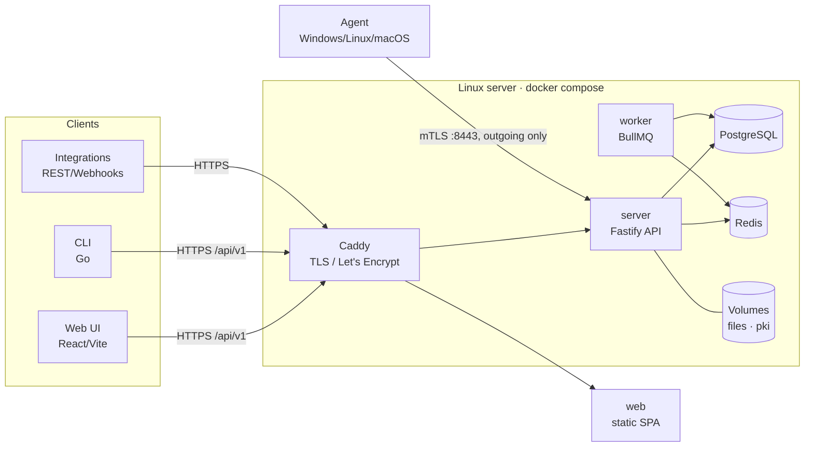

<p align="center">
  <a href="README.md"></a>
  <a href="README.de.md"></a>
</p>
<p align="center"><b>🌐 Language:</b> <b>English</b> · <a href="README.de.md">Deutsch</a></p>

<p align="center">
  <picture>
    <source media="(prefers-color-scheme: dark)" srcset="docs/images/logo-dark.svg">
    
  </picture>
</p>

<h1 align="center">OpenCM</h1>

<p align="center">
  <b>Free, self-hosted client management for Windows, Linux and macOS.</b><br>
  Inventory · Scripts & jobs · Vulnerability detection · Security status · Software distribution · Patch management · Reports
</p>

<p align="center">
  
  
  
  
</p>

---

## What is OpenCM?

OpenCM is an **open-source client management platform** that you run on your own server. It gives IT administrators one place to see and control every computer in the organisation:

- **What is there?** Hardware, operating systems, installed software, users and the security status of each device, plus devices without an agent such as monitors, printers and phones.
- **What is at risk?** Installed software is compared with the NVD, CISA KEV and OSV vulnerability databases. Missing operating-system updates and weak security settings (e.g. BitLocker off) are reported.
- **What needs to change?** Scripts, software packages and updates are rolled out in stages to selected devices, with approvals, four-eyes control and tamper protection.

A small agent runs on each device. It only ever opens **outgoing** connections to the server, encrypted and mutually authenticated (mTLS). Everything is operated from the **web interface**, the **`opencm` command-line tool** or the **REST API**.

OpenCM is **free software under the MIT license**. There are no license keys and no limits on devices, users or features.

**[Image: Dashboard – overview tiles (devices, vulnerabilities, security status, updates) and trend charts]**

---

## Table of contents

1. [Highlights](#highlights)
2. [Screenshots](#screenshots)
3. [Features in detail](#features-in-detail)
   - [Inventory](#inventory)
   - [Assets without an agent](#assets-without-an-agent)
   - [Scripts & jobs](#scripts--jobs)
   - [Vulnerability detection](#vulnerability-detection)
   - [Security status](#security-status)
   - [Software distribution](#software-distribution)
   - [Patch management](#patch-management)
   - [Dashboard & reports](#dashboard--reports)
   - [Webhooks](#webhooks)
   - [Software license management](#software-license-management)
   - [Users, roles & sign-in](#users-roles--sign-in)
   - [Tamper protection](#tamper-protection)
4. [Architecture](#architecture)
5. [Installation](#installation)
6. [Enrolling devices](#enrolling-devices)
7. [Command-line tool (CLI)](#command-line-tool-cli)
8. [REST API](#rest-api)
9. [Configuration](#configuration)
10. [Security](#security)
11. [Backup, restore & updates](#backup-restore--updates)
12. [Development](#development)
13. [Project status & roadmap](#project-status--roadmap)
14. [Further documentation](#further-documentation)
15. [License](#license)

---

## Highlights

| | |
|---|---|
| 🖥️ **Cross-platform agent** | One agent (Go) for Windows, Linux and macOS, running as a service, outgoing mTLS only, signed self-update |
| 📋 **Complete inventory** | Hardware, OS, software, services, users, patches, change history, custom fields, plus assets without an agent |
| ⚙️ **Automation** | Script library with versions and approval, jobs with schedules, maintenance windows, retries and live output |
| 🛡️ **Vulnerabilities** | NVD mirror, CISA KEV, FIRST EPSS, OSV for Linux distributions, remediation jobs straight from a CVE |
| 🔒 **Security status** | BitLocker / FileVault / LUKS, Defender and other antivirus products, firewall, Secure Boot, TPM, with a compliance rating |
| 📦 **Software & patches** | Package repository, staged rollout in rings, bandwidth limits, Windows Update / apt / dnf / softwareupdate |
| 📊 **Reports** | Dashboard with trends, report builder over 8 data sources, CSV export |
| 🔔 **Integration** | Signed webhooks, complete REST API (OpenAPI 3.1), CLI for every module |
| 👥 **Access control** | Granular roles, scopes on device groups, four-eyes approvals, MFA, API tokens, LDAP / Active Directory |
| 🔐 **Tamper protection** | SHA-256 + HMAC seal on every script and file, checked again on the device before execution |

---

## Screenshots

**[Image: Device list – search, OS filter, online status]**

**[Image: Device detail page – tabs for overview, security, vulnerabilities, updates, software, history]**

**[Image: Script editor with syntax highlighting, parameters and test run on one device]**

**[Image: Run view – live output (stdout/stderr) and exit code per device]**

**[Image: Vulnerabilities – risk-sorted CVE list with severity, KEV marker and EPSS]**

**[Image: Security status – tiles "not compliant / unencrypted / antivirus problems" and device table]**

**[Image: Software distribution – rollout in rings (test → pilot → all) with progress bars]**

**[Image: Report builder – choosing columns, filters and a live preview]**

**[Image: Assets – list of monitors and printers with warranty badges, CSV import dialog]**

---

## Features in detail

### Inventory

The agent collects a full inventory every 24 hours, or immediately on request:

| Area | Windows | Linux | macOS |
|---|---|---|---|
| Hardware, BIOS, serial number | CIM | `/sys/class/dmi`, `/proc` | `system_profiler` |
| Operating system | CIM + registry (build, UBR) | `/etc/os-release`, kernel | `system_profiler`, `sysctl` |
| Software | Uninstall keys (64/32 bit), MSI, MSIX/Store | dpkg, rpm (incl. source package) | Applications |
| Patches | installed hotfixes | via patch scan | `softwareupdate --history` |
| Services, autostart | services, startup commands | systemd, XDG autostart | launchd |
| Users & groups, logged-on users | CIM + ADSI | `/etc/passwd`, `/etc/group`, `who` | `dscl`, console user |
| Network, disks | ✔ | ✔ | ✔ |
| Security status | BitLocker, Defender, firewall, Secure Boot, TPM | LUKS, ufw/firewalld/nftables, Secure Boot, TPM, ClamAV/Defender | FileVault, firewall, XProtect/Gatekeeper |

- **Change history:** every change to hardware, OS, software, patches, services, users, groups and security settings is recorded per device. Volatile values such as free disk space or IP addresses are not recorded.
- **Custom fields:** text, number, yes/no or date. They are filled in by hand or automatically by a script in a job.
- **Dynamic device groups:** groups are built from filters on device fields, online status, installed software, custom fields or security status (e.g. *"all notebooks without BitLocker"*), with a live preview.

**[Image: Dynamic group filter builder with conditions and preview of matching devices]**

### Assets without an agent

Monitors, printers, phones, network gear, docking stations and devices in stock can be recorded without an agent.

- **Fields:** type, status (in stock, in use, repair, retired), manufacturer, model, serial number, unique inventory number, location, assigned person, IP/MAC, purchase date, warranty end, cost and notes.
- **Linking:** an asset can be linked to a managed device; it then appears in that device's *Accessories* tab (e.g. the monitors of a PC).
- **CSV import** in Excel format (`;` or `,`, German or English column names):
  - A dry run shows what would change before anything is written.
  - Existing assets are matched by inventory number, otherwise by serial number.
- **CSV export** in the same format, so the file can be imported again.
- **Warranty overview:** filters for warranties ending in 30/90 days, a dashboard tile and a report source.

### Scripts & jobs

- **Script library:**
  - Languages: PowerShell, CMD, Bash, zsh and Python.
  - Every change creates a new **immutable version**. A version goes from draft to approved to retired; only approved versions can run.
  - Parameters reach the script as environment variables `OPENCM_PARAM_<NAME>`.
  - Editor with syntax highlighting (CodeMirror), templates (winget, Chocolatey, apt, dnf, macOS updates …) and a **test run on a single device** (drafts can only be test-run by users who may also approve scripts).
- **Jobs:**
  - A job combines one or more steps with targets (devices, static or dynamic groups, all devices).
  - **Triggers:** now, once, cron (with time zone), agent start or user logon.
  - **Options:** maintenance windows, retries, timeout and "continue on error" per step.
- **Live output:**
  - stdout, stderr and the exit code per device, streamed while the script runs.
  - Runs can be cancelled, including tasks that are already running.
  - Failed devices can be re-run.
- **Signed tasks:** every task is signed with Ed25519, and the agent refuses anything unsigned or modified.

**[Image: Job editor – steps, targets, schedule and maintenance window]**

### Vulnerability detection

- **Sources:**
  - **NVD** (complete mirror; it resumes where it stopped and is then kept up to date incrementally).
  - **CISA KEV**: actively exploited vulnerabilities, including the CISA deadline.
  - **FIRST EPSS**: the probability that a vulnerability will be exploited.
  - **OSV**: the advisories of the Linux distributions.
- **Matching installed software to CPEs:**
  - About 60 built-in rules, your own glob rules and a heuristic.
  - Suggestions for software that could not be matched.
- **Linux distributions (OSV):**
  - Covers Debian, Ubuntu, Rocky Linux and AlmaLinux packages, checked by source package and exact version.
  - Back-ported fixes are recognised, so a patched `openssl 3.0.2` on Ubuntu is not reported.
  - Only package names and versions are sent to osv.dev, never host names.
- **Findings:**
  - Sorted by risk (KEV, CVSS, EPSS), with confidence levels and a list of affected devices.
  - **Risk acceptance** requires a mandatory justification and is logged in the audit log.
- **Remediation:** a job is created directly from a CVE for all affected devices and can be run immediately.
- **Notifications** for new critical or actively exploited findings via webhook.

**[Image: CVE detail page – description, CVSS, KEV deadline, affected devices and "Create remediation job" button]**

### Security status

Every inventory includes the device's security posture. The queries are read-only.

| | Windows | macOS | Linux |
|---|---|---|---|
| Disk encryption | BitLocker per drive (incl. "suspended") | FileVault | LUKS / dm-crypt |
| Antivirus | Microsoft Defender + third-party products from Security Center | XProtect + Gatekeeper | Defender for Endpoint, ClamAV (optional) |
| Firewall | Domain / Private / Public profiles | Application firewall | ufw, firewalld, nftables |
| Platform | Secure Boot, TPM | – | Secure Boot, TPM |

- **Compliance rule:** a device is *compliant* when its disks are encrypted, the firewall is on and, on Windows and macOS, an up-to-date antivirus with real-time protection is active.
- **Issues** have clear names, e.g. *"System drive not encrypted"* or *"Antivirus signatures outdated"*. They can be filtered and exported as CSV.
- **Webhook** `device.security_changed`: fired when a device's status gets worse.
- **Where it shows up:** dashboard tile, trends, dynamic group filters and the report source *Security status*.

### Software distribution

- **Package repository** with 11 types: MSI, EXE, winget, Chocolatey, DEB, RPM, apt, dnf, PKG, Homebrew and custom commands.
- **Installer files:**
  - Uploads are streamed, deduplicated by SHA-256 and limited in size.
  - Agents download over mTLS; interrupted downloads resume (Range).
- **Detection rules** decide whether a package is already installed or the installation succeeded: software with a version, file, registry value or a command. They are checked before and after installing.
- **Exit codes:** you define which codes count as success and which as "restart needed".
- **Versions with approval** (optionally four-eyes); an approved version can no longer be changed (enforced by the database).
- **Rollout in rings** (e.g. Test → Pilot → All):
  - The next ring starts automatically after a waiting time and a minimum success rate.
  - A ring pauses automatically when too many devices fail; it can be resumed or cancelled.
- **Bandwidth limit** for the whole server and per device.
- **Compliance:** shows on which devices which version is installed, taken from the inventory.

**[Image: Package detail – versions, detection rules, generated script preview and deployment form]**

### Patch management

- **Scans:**
  - Pending updates are found with Windows Update Agent (also via WSUS), apt, dnf/yum and softwareupdate.
  - Scans run automatically (e.g. every 24 h) or manually.
- **Installation:**
  - Updates are chosen by classification (e.g. security only) or individually, and rolled out in rings.
  - A restart policy applies, and a new scan runs after installation.
- **Overviews** per device and per update, including missing security updates and pending restarts, exportable as CSV.

**[Image: Patch overview – devices with missing security updates and pending restarts]**

### Dashboard & reports

- **Dashboard:**
  - Key figures per area: devices, vulnerabilities, security status, updates, failed tasks, rollouts, approvals, licenses and assets.
  - What you see depends on your permissions and device scope.
- **Trends** over 30, 90 or 365 days. The worker stores the values hourly.
- **Report builder** with 8 data sources: devices, software, vulnerability findings, pending updates, task results, software licenses, security status and assets.
  - Pick columns, filter with 11 operators and sort; a live preview shows the result.
  - Reports can be private or shared with others.
  - Export as CSV for Excel or as JSON, up to 100,000 rows.

### Webhooks

Webhooks send signed notifications to other systems such as a ticket system, chat or SIEM.

| Event | When |
|---|---|
| `device.enrolled` | a new device was enrolled |
| `run.completed` / `task.failed` | a run finished / a task failed for good |
| `deployment.completed` / `deployment.paused` | a rollout finished / was paused |
| `approval.requested` | a four-eyes approval is needed |
| `vulnerability.findings.new` | new critical or actively exploited findings |
| `patch.scan_failed` | a patch scan failed |
| `security.integrity_violation` | a hash check failed (tampering suspected) |
| `license.overused` | more installations than licenses |
| `device.security_changed` | a device's security status got worse |

- **Signature:** `X-OpenCM-Signature: sha256=HMAC(secret, timestamp + "." + body)`.
- **Delivery:** retries after 1 min, 5 min, 30 min, 2 h and 6 h, with a delivery log and "redeliver".
- **Protection:** link-local and cloud-metadata addresses are refused as targets, also when a host name resolves to them.

### Software license management

This module manages the licenses your organisation owns for **third-party software** (e.g. office suites).

- Software patterns are matched against the inventory to show used, free and **over-used** licenses.
- Contracts that expire soon are flagged, and costs can be recorded.
- Over-use triggers the webhook `license.overused`.

> This has nothing to do with OpenCM's own license: OpenCM is MIT-licensed and unrestricted.

### Users, roles & sign-in

- **Roles** with granular permissions per module and action (`devices:read`, `jobs:execute`, `software:approve` …), plus built-in roles: Administrator, Auditor and Helpdesk.
- **Scopes:** a role can be limited to device groups, e.g. "helpdesk Munich may only see Munich devices". Devices outside the scope stay invisible (the API returns 404).
- **Four-eyes approval:**
  - Required for mass actions (all devices or more than a threshold), for activating broad schedules and for rollouts.
  - You cannot approve your own request.
- **MFA (TOTP):** set up with a QR code; 10 recovery codes; can be made mandatory; admins can reset it.
- **API tokens:** a token never has more rights than its owner, has a maximum lifetime and can be revoked.
- **LDAP / Active Directory:** sign-in with nested AD groups mapped to OpenCM groups; the user account is created automatically at first sign-in.
- **Audit log:** every write action is recorded. The log is append-only (enforced by a database trigger) and can be exported as CSV or JSON.

**[Image: Role editor – permission matrix per module and action]**

### Tamper protection

Everything that runs on a device gets a **SHA-256 hash** when it is saved: script versions, installer files and the steps generated for packages and patches. The hash is compared 1:1 several times:

| When | Check |
|---|---|
| Creating a run | content ↔ stored hash ↔ source (approved version) ↔ HMAC seal |
| Delivery to the device | the same check again; the task is signed with Ed25519 |
| Approving a package / starting a ring | the installer file in the repository is re-hashed |
| On the device | signature, hash of every step, of the downloaded file and of the script file on disk right before it starts |

If anything does not match, **nothing is executed**:

- The task fails with *"Hash check failed"*.
- Rollouts pause.
- An audit entry `security.integrity_violation` is written and the webhook of the same name fires.

The seal key is stored outside the database, so even someone with write access to the database cannot forge a matching hash.

---

## Architecture



| Component | Technology | Role |
|---|---|---|
| **server** | Node.js ≥ 24, TypeScript, Fastify 5, Drizzle ORM | REST API `/api/v1`, auth, RBAC, audit, mTLS endpoint for agents; runs DB migrations on start |
| **worker** | BullMQ / Redis | Background work: job dispatch, schedules, feed syncs (NVD, KEV, EPSS, OSV), rollouts, patch scans, webhooks, metrics |
| **web** | React 18 + Vite + TypeScript | Web interface; talks only to the public API |
| **proxy** | Caddy | TLS termination with Let's Encrypt, routing |
| **database** | PostgreSQL 16 | All data; migrations are versioned |
| **cli** | Go, Cobra | `opencm` – multiple server profiles, table/JSON/YAML output, shell completion |
| **agent** | Go | `opencm-agent` – service on Windows, systemd, launchd |

**[Image: Architecture diagram (rendered)]**

---

## Installation

**Requirements:** a Linux server with Docker and Docker Compose (2.23 or newer), a DNS name (or just the server's IP address for a local test) and the ports **443/80** (web) and **8443** (agents) open. Only `docker-compose.yml` and `.env` are needed on the server.

```bash
git clone https://github.com/Melone155/OpenCM.git opencm
cd opencm/deploy
cp .env.example .env
# edit .env: OPENCM_DOMAIN, ACME_EMAIL, POSTGRES_PASSWORD, BOOTSTRAP_ADMIN_PASSWORD
docker compose pull
docker compose up -d
```

The images come ready-built from the GitHub Container Registry (`ghcr.io/melone155/opencm-server`, `ghcr.io/melone155/opencm-web`). `OPENCM_VERSION` in `.env` selects the tag (`latest` or a release such as `0.8.0`). To build the images yourself instead, run `docker compose up -d --build`.

Then open `https://<OPENCM_DOMAIN>` and sign in with the bootstrap admin. The interactive API documentation is at `/api/docs`.

| Port | Service | Note |
|---|---|---|
| 443 / 80 | Caddy → web UI + REST API | Let's Encrypt certificate obtained automatically |
| 8443 | Agent endpoint (mTLS) | Published directly by the server container. TLS must end in the server, because a TLS proxy in front would drop the client certificate. |

> **Tip:** remove `BOOTSTRAP_ADMIN_PASSWORD` from `.env` after the first start, and enable MFA for the admin account.

---

## Enrolling devices

1. In the web UI go to **Devices → Add devices** and create an enrollment token (validity up to one year or unlimited, maximum number of devices, optional target group). Deleting a token stops it immediately; enrolled devices stay.
2. Run the displayed one-line command on the device: in PowerShell as administrator on Windows, as root on Linux and macOS. It downloads the agent, enrolls it and installs the service. It also works when the browser warns about the certificate (IP address, local CA): the install script and the agent are verified by SHA-256 checksums, and the agent pins the server's CA and signing key (`--server-pin`). Errors are shown as a message and never close your SSH session.
3. The device appears within seconds; the first inventory follows with the first heartbeat.

**[Image: "Add devices" page with token and copy-ready install commands for Windows, Linux and macOS]**

Manual commands:

```text
opencm-agent enroll --server https://cm.example.org --token oce_…   [--ca-file internal-ca.pem]
opencm-agent install
opencm-agent status        # device ID, endpoint, certificate expiry
opencm-agent inventory     # show the local inventory as JSON (sends nothing)
opencm-agent uninstall
```

| OS | Program | Configuration / data | Service | Log |
|---|---|---|---|---|
| Windows | `C:\Program Files\OpenCM\opencm-agent.exe` | `C:\ProgramData\OpenCM\` | `OpenCMAgent` | `C:\ProgramData\OpenCM\logs\agent.log` |
| Linux | `/usr/local/bin/opencm-agent` | `/etc/opencm/`, `/var/lib/opencm/` | systemd `opencm-agent` | `journalctl -u opencm-agent` |
| macOS | `/usr/local/bin/opencm-agent` | `/Library/Application Support/OpenCM/` | launchd `org.opencm.agent` | `/Library/Logs/OpenCM/agent.log` |

**Agent behaviour:**

- **Heartbeat:** every 60 s. A device counts as online when it has checked in within 3 intervals.
- **Inventory:** every 24 h, or immediately on request.
- **Connection errors:** the agent retries with exponential back-off, up to 15 min between attempts.
- **Client certificate:** renewed automatically before it expires.
- **Revocation** takes effect immediately.

---

## Command-line tool (CLI)

The `opencm` CLI covers every module and uses the same API as the web interface.

```bash
opencm login --server https://cm.example.org -u admin --otp 123456
opencm devices list --filter "os=windows,online=true"
opencm enrollment-tokens create --name "Rollout" --max-uses 25 --os windows

# scripts & jobs
opencm scripts run <script-id> --target group:Accounting --param Days=7 --watch
opencm jobs status <run-id> --watch
opencm tasks output <task-id> --follow

# vulnerabilities
opencm cve list --severity critical
opencm cve remediate CVE-2024-1234 --script <id> --param PackageId=Mozilla.Firefox --run

# software & patches
opencm packages create "7-Zip" --platform windows
opencm packages add-version 7-Zip 24.08 --type msi --detect-software "7-Zip*>=24.08"
opencm packages upload 7-Zip 24.08 ./7z2408-x64.msi && opencm packages approve 7-Zip 24.08
opencm deploy 7-Zip --ring Test=group:IT --ring All=all --delay 24
opencm patches install --classification security --ring Test=group:IT --ring All=all

# security status & assets
opencm security status --compliant no
opencm assets import inventory.csv --dry-run && opencm assets import inventory.csv
opencm assets list --warranty-days 30

# reports, webhooks, administration
opencm dashboard
opencm reports query software --filter "name contains firefox" --filter "version lt 130"
opencm webhooks create Tickets https://tickets.example.org/hooks/opencm --event security.integrity_violation
opencm tokens create ci --permission devices:read --days 30
opencm approvals list && opencm approvals approve <id>
opencm audit export --format csv -f audit.csv
opencm completion powershell | Out-String | Invoke-Expression
```

- Output as a table (default) or with `-o json|yaml` for scripts.
- Several servers are managed as profiles (`--profile`).
- **Exit codes:** 0 OK · 1 error · 2 usage · 3 not signed in · 4 forbidden · 5 not found · 6 conflict · 7 run failed (`--watch`) · 8 waiting for approval.

---

## REST API

- **OpenAPI 3.1** is the single source of truth: `server/openapi.yaml`, interactive at `/api/docs`.
- A contract test ensures that every route is documented and every documented operation exists.
- **Authentication:** session token (`Authorization: Bearer …`) or API token. In the browser, an httpOnly cookie is used.
- **Permissions:** every operation states the permission it needs in `x-permission`.
- **Errors** always have the form `{ "error": { "code", "message", "details?" } }`.

```bash
curl -H "Authorization: Bearer $OPENCM_TOKEN" https://cm.example.org/api/v1/security-status?compliant=false
```

---

## Configuration

All settings are environment variables in `deploy/.env`; `deploy/.env.example` documents each one. The most important:

| Variable | Default | Meaning |
|---|---|---|
| `OPENCM_DOMAIN`, `ACME_EMAIL` | – | Public host name and e-mail for Let's Encrypt |
| `POSTGRES_PASSWORD` | – | Database password |
| `BOOTSTRAP_ADMIN_USER` / `_PASSWORD` | – | First admin (first start only) |
| `AGENT_HEARTBEAT_SECONDS` | `60` | Agent check-in interval |
| `FOUR_EYES_ENABLED`, `FOUR_EYES_DEVICE_THRESHOLD` | `true`, `50` | Four-eyes approval for mass actions |
| `MFA_REQUIRED` | `false` | Make MFA mandatory for everyone |
| `LDAP_URL`, `LDAP_BIND_DN`, `LDAP_BASE_DN` … | – | LDAP / Active Directory sign-in |
| `VULN_FEEDS_ENABLED`, `NVD_API_KEY` | `true`, – | Vulnerability feeds; an NVD key (free) speeds up the first mirror |
| `OSV_ENABLED` | `true` | OSV check for Linux distribution packages |
| `SECURITY_AV_MAX_AGE_DAYS` | `3` | Antivirus signatures older than this count as outdated |
| `PACKAGE_MAX_BYTES`, `PACKAGE_BANDWIDTH_KBPS` | 4 GiB, `0` | Upload limit, download bandwidth (0 = unlimited) |
| `PATCH_SCAN_INTERVAL_HOURS` | `24` | Automatic patch scan |
| `WEBHOOK_ALLOW_HTTP` | `false` | Allow plain-http webhook targets |

> **Offline networks:** set `VULN_FEEDS_ENABLED=false`. For an HTTP proxy use `NODE_USE_ENV_PROXY=1` and `HTTPS_PROXY=…`.

---

## Security

- **Agents:**
  - Connections use mTLS with OpenCM's own CA (ECDSA P-256), and the agent only connects outwards.
  - Tasks are signed with Ed25519, and so are agent updates.
- **Tamper protection:** SHA-256 plus an HMAC seal on everything that is executed (see [Tamper protection](#tamper-protection)).
- **Passwords and tokens:** passwords are hashed with Argon2id. Session and API tokens are stored only as SHA-256 hashes. MFA secrets are encrypted with AES-256-GCM.
- **Least privilege:** permissions per module and action, scopes on device groups and four-eyes approvals.
- **Audit:** an append-only audit log with export.
- **No SQL from clients:** report filters are compiled from whitelists and values are bound as parameters.
- **Privacy:** OSV receives only package names and versions. No telemetry is sent to anyone.

> **Important secrets** live in the `pki` volume: `ca.key` (agent CA), `integrity.key` (seal key) and `secrets.key` (encryption). They are part of the backup, so **store backups encrypted**.

---

## Backup, restore & updates

```bash
deploy/backup.sh                 # database dump + volumes "files" and "pki"
deploy/restore.sh <dir> --yes    # restore
docker compose pull && docker compose up -d   # update; migrations run automatically
```

---

## Development

Requirements: Node.js ≥ 24 and Go 1.23 for the CLI and agent. Docker is not needed for development.

```bash
npm install
npm test                 # 177 server tests against embedded Postgres (PGlite), incl. real mTLS
npm run lint             # TypeScript type check (server + web)

# API with embedded Postgres
cd server
DATABASE_URL=pglite://./.devdb BOOTSTRAP_ADMIN_USER=admin BOOTSTRAP_ADMIN_PASSWORD=admin-password-123 npm run dev
# → http://localhost:8080/api/docs

npm run dev -w web       # web UI on http://localhost:5173
cd cli && go test ./...
cd agent && go test ./...
```

| Directory | Content |
|---|---|
| `server/` | REST API, worker, migrations (`drizzle/`), OpenAPI specs, tests |
| `web/` | Web interface (React) |
| `cli/` | `opencm` command-line tool (Go) |
| `agent/` | `opencm-agent` (Go) |
| `deploy/` | Docker Compose, Caddy, backup scripts |
| `docs/` | Architecture, operations manual, roadmap |

Rules for contributions:

- **OpenAPI first**: a new route is added to the spec before it is implemented.
- Every database change goes through a migration.
- Code and identifiers are in English; the documentation is in German.

---

## Project status & roadmap

**Version 0.8.0.** All milestones are complete:

| Milestone | Content |
|---|---|
| M0 | Foundation: users, roles, audit, API, web, CLI, Docker |
| M1 | Agent & inventory |
| M2 | Scripts & jobs |
| M3 | Vulnerability detection (NVD, KEV, EPSS) |
| M4 | Permissions: scopes, four-eyes, MFA, API tokens, LDAP/AD |
| M5 | Software distribution in rings, patch management, tamper protection |
| M6 | Dashboard, reports, webhooks, software license management |
| M7 | OSV for Linux distributions, security status, assets without an agent |

**Possible next steps:**

- PDF export of reports.
- A webhook event for "device offline".
- Dependencies between jobs.
- Automatic discovery of devices on the network.
- OSV support for RHEL, SUSE and Alpine.
- OIDC/SAML single sign-on.

The detailed status is in the [roadmap](docs/roadmap.md).

> **Note:** the server is covered by automated tests, and the Windows inventory has been checked on a real machine. A larger field test with real devices of all three platforms is still outstanding.

---

## Further documentation

These documents are in German:

- [`docs/operations.md`](docs/operations.md) – operations manual: ports, PKI, agents, inventory, jobs, vulnerabilities, permissions, rollouts, security status, assets, webhooks, tamper protection
- [`docs/architecture.md`](docs/architecture.md) – architecture and design decisions
- [`docs/roadmap.md`](docs/roadmap.md) – roadmap and feature status
- [`CHANGELOG.md`](CHANGELOG.md) – changes per version
- API: `server/openapi.yaml` or `/api/docs` on your server

---

## License

OpenCM is free software under the [MIT license](LICENSE). Anyone may use, modify and distribute it free of charge, including commercially. There are no license keys and no limits on devices or features.

<p align="center"><sub>🌐 <a href="README.md">English</a> · <a href="README.de.md">Deutsch</a></sub></p>
