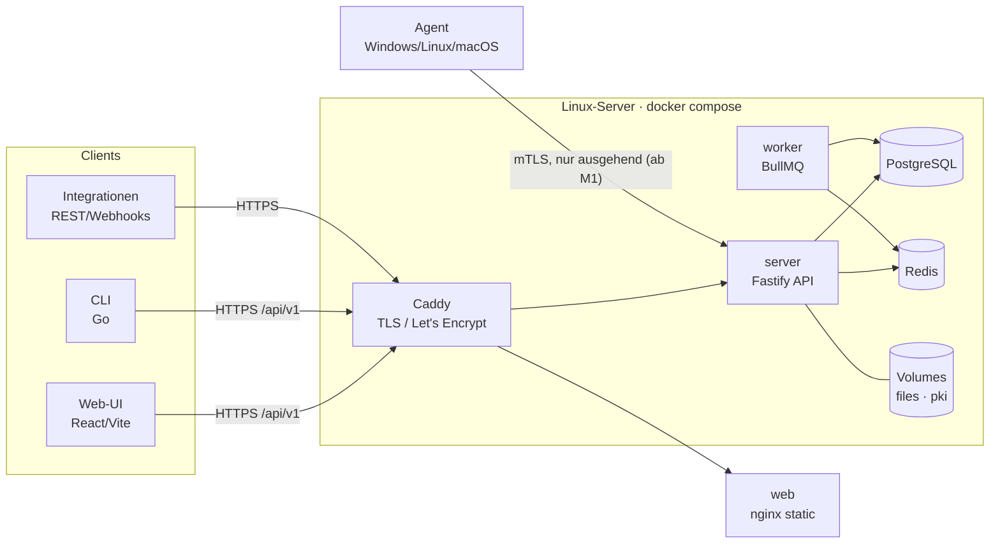

<picture><source media="(prefers-color-scheme: dark)" srcset="images/logo-dark.svg"></picture>

# Architektur

## Komponenten
| Komponente | Aufgabe |
|---|---|
| **server** | REST-API `/api/v1`, Auth, RBAC, Audit. Führt beim Start die DB-Migrationen aus und legt Systemrollen und den Bootstrap-Admin an. Swagger-UI unter `/api/docs`. |
| **worker** | Hintergrundjobs über BullMQ/Redis. M0: Aufräumen abgelaufener Sessions. Später: Job-Dispatch, NVD/KEV-Sync, Webhooks. |
| **web** | Statisches SPA (nginx) mit CSP-Headern. Spricht ausschließlich `/api/v1`. |
| **proxy** | Caddy: TLS-Terminierung, Routing `/api/*` → server, Rest → web. |
| **cli** | `opencm` (Go). Profile mehrerer Server, Ausgabe als Tabelle, JSON oder YAML, Shell-Completion. |
| **agent** | `opencm-agent` (Go), läuft als Dienst und verbindet sich nur ausgehend. Ab M1 mTLS mit eigener CA. |

## Querschnitt
- **OpenAPI first:** `server/openapi.yaml` ist die Quelle der Wahrheit. Ein Contract-Test erzwingt Route ↔ Spec. Die Web-Typen werden daraus generiert (`openapi-typescript`), der Go-Client ab M1 (`oapi-codegen`).
- **Auth:** opake Session-Tokens (256 Bit). Die DB speichert nur SHA-256-Hashes. Die CLI sendet das Token als Bearer, der Browser bekommt es als httpOnly-Cookie (`SameSite=Strict`, Pfad `/api`). Passwörter werden mit Argon2id gehasht (m=19 MiB, t=2, p=1).
- **RBAC:** Rechte im Format `modul:aktion` mit Wildcards `modul:*` und `*`. Effektive Rechte = eigene Rollen ∪ Rollen der Gruppen. Ein **Eskalationsschutz** sorgt dafür, dass niemand Rollen definiert oder vergibt, deren Rechte er selbst nicht hat. Systemrollen sind unveränderlich.
- **Audit:** Jede schreibende Aktion sowie Login, Logout und Fehlversuch landen im Log. Ein DB-Trigger verhindert UPDATE, DELETE und TRUNCATE. Passwörter werden nie geloggt.
- **Agent-Kommunikation (M1):** Die Registrierung läuft über die öffentliche API (Enrollment-Token + CSR). Danach spricht der Agent ausschließlich den mTLS-Endpoint (:8443) an, mit eigener CA in beide Richtungen: Der Agent vertraut nur der OpenCM-CA, der Server nur von ihr ausgestellten Client-Zertifikaten. Jede Anfrage wird zusätzlich gegen den gespeicherten Zertifikats-Fingerprint geprüft, das ersetzt eine CRL und macht Widerruf sofort wirksam. Spec: `server/openapi-agent.yaml`.
- **Inventar:** Snapshot (jsonb), normalisierte Software (`device_software`, Grundlage für den CVE-Abgleich in M3) und Änderungshistorie (`device_history`) als Diff zweier Snapshots.
- **Jobs (M2):**
  - Ein Run friert Schritte und Optionen des Jobs als Snapshot ein; spätere Änderungen am Job betreffen laufende Runs nicht. Daraus entsteht ein Task je Gerät.
  - Der Agent holt Aufträge per Long-Poll über mTLS ab (Latenz etwa 1 s).
  - Jeder Auftrag ist ein signiertes Envelope `{payload, signature}` (Ed25519 über die exakten Payload-Bytes, keine Kanonisierung nötig).
  - Der Scheduler ist eine idempotente Funktion (`schedulerTick`). Er wird vom BullMQ-Worker alle 15 s aufgerufen und vergibt Aufträge über optimistische Claims in der DB, deshalb ist er mehrinstanzfähig.
- **CVE-Erkennung (M3):**
  - Vom NVD-Spiegel werden nur die Kriterien für Anwendungen gespeichert (`vuln_cpe_matches`: vendor/product + Versionsbereich), nicht die vollständigen NVD-Konfigurationen. Das hält die Datenbank klein.
  - Die Heuristik ordnet Software nur Produkten zu, die tatsächlich CVEs haben; der Produkt-Index wird nach jedem Sync neu aufgebaut.
  - Feeds und Bewertung laufen in einer eigenen BullMQ-Queue (`opencm-feeds`), damit ein langer NVD-Lauf den Job-Scheduler nicht blockiert. Gegen Parallelläufe schützt ein Lease-Lock je Feed in `feed_state`; Wiederaufnahme über einen Cursor.
- **Berechtigungen (M4):**
  - Rollenzuweisungen tragen optional `scopeDeviceGroupIds`. `requirePermission` prüft ausschließlich **globale** Rechte (sicherer Standard für alle Verwaltungsrouten). Nur gerätebezogene Routen verwenden `requireScopedPermission` und filtern über `app.deviceScope()` per SQL (`scopeCondition`). Geräte außerhalb des Bereichs liefern 404, damit ihre Existenz nicht verraten wird.
  - API-Tokens: effektive Rechte = Rechte des Besitzers ∩ Token-Rechte, zu jedem Zeitpunkt neu berechnet. Entzieht man dem Besitzer Rechte, verliert sie auch das Token.
  - MFA: TOTP-Geheimnisse sind mit AES-256-GCM verschlüsselt (Schlüssel `PKI_DIR/secrets.key`). Der zuletzt benutzte Zeitschritt wird gespeichert (Replay-Schutz), Wiederherstellungscodes nur als Hash. Bei verpflichtender MFA ohne Einrichtung bekommt die Session `mfa_pending`; dann sind nur `requireSession`-Routen erreichbar.
  - LDAP läuft hinter dem Interface `Directory`, damit Tests ein simuliertes Verzeichnis einsetzen können. Filterwerte werden nach RFC 4515 escaped; leere Passwörter werden vor dem Bind abgelehnt (sonst gilt ein *unauthenticated bind* als Erfolg).
- **Softwareverteilung & Patches (M5):**
  - Es gibt keine zweite Ausführungs-Engine. Paketversionen und Patch-Aktionen werden serverseitig in Skript-Schritte übersetzt (`packages/generate.ts`, `patches/scripts.ts`) und laufen als normale Runs/Tasks. Alle Werte aus der Paketdefinition werden als quotierte Literale eingebettet (PowerShell `'…'` inkl. typografischer Quotes, POSIX `'…'`). Eigene Befehle werden Base64-kodiert an einen Kindprozess übergeben, nie in das Skript gespliced.
  - Ringe: Eine Verteilung (`deployments`) friert die erzeugten Schritte je Betriebssystem ein. Jeder Ring wird zu einem Run je OS (`job_runs.deployment_id`, `ring`). Das Weiterschalten macht der Worker-Tick (`deploymentTick`) über optimistische Claims auf `current_ring`.
  - Dateien: Der Payload wechselt auf `v: 2`, sobald ein Schritt `files` trägt. Ältere Agents lehnen ihn ab, statt ohne Datei loszulaufen. Der Agent-Endpoint liefert nur Dateien aktiver Tasks des Geräts aus, mit Range-Unterstützung und Token-Bucket-Drosselung (global + je Gerät).
  - Patch-Scans geben zwischen Markern ein zeilenbasiertes Format aus. `afterTaskFinished` übernimmt es nach dem Task-Ende in `device_patches` und ersetzt dabei den bisherigen Stand.
- **Integrität:**
  - Jeder auszuführende Inhalt hat einen SHA-256. Beim Anlegen eines Runs und erneut bei der Auslieferung wird er gegen Inhalt, Quelle (Skript- bzw. Paketversion) und ein **HMAC-Siegel** geprüft; der Schlüssel liegt in `PKI_DIR/integrity.key`, nicht in der DB.
  - Der Agent prüft Signatur, Schritt-Hashes, Datei-Hashes und die Skriptdatei auf dem Datenträger.
  - Verstöße: Task `failed` mit `integrity:`-Fehler, keine Wiederholung, Audit-Eintrag `security.integrity_violation`.
- **Berichte, Webhooks, Kennzahlen (M6):**
  - Berichte: `reports.ts` definiert Quellen mit festen Spalten-Ausdrücken. Filter werden aus der Whitelist zu parametrisierten Bedingungen kompiliert, es gibt keinen SQL-Text vom Client. Der Geltungsbereich wird wie bei den Geräte-Routen angehängt.
  - Webhooks als Outbox: `emitEvent()` schreibt nur Zeilen in `webhook_deliveries`, ohne Netzwerkzugriff in der auslösenden Transaktion und ohne Ausnahmen nach außen. Der Worker stellt in einer eigenen Queue zu (Lease per optimistischem Claim auf `attempts`), signiert mit HMAC über Timestamp + Body und prüft das Ziel bei jeder Zustellung erneut per DNS auf Link-Local/Metadaten (Schutz vor DNS-Rebinding). Geheimnisse liegen verschlüsselt mit der Secretbox in der DB.
  - Kennzahlen: `metrics_daily` (Tag, Schlüssel) wird stündlich per Upsert geschrieben. Das Dashboard rechnet live und auf den Geltungsbereich bezogen; Trends sind flottenweit und nur bei globalem Leserecht sichtbar.
- **OSV, Sicherheitsstatus, Assets (M7):**
  - OSV ist ein weiterer Feed im bestehenden `feedTick` (gleiche Lease-/Backoff-Mechanik). Er arbeitet inkrementell: Der Cache `osv_packages` (Ökosystem, Paket, Version → Meldungs-IDs) wird nur für neue oder veraltete Tripel per `querybatch` befüllt, Details landen in `osv_vulns`. `evaluateFindings` liest den Cache. Pakete, die OSV geprüft hat, überspringen den CPE-Abgleich; so bleibt es bei einer einzigen Bewertungsrunde mit konsistentem Öffnen/Schließen von Befunden. Gesendet werden nur Paketidentitäten.
  - Der Sicherheitsstatus ist Teil des Inventars (`security`). `ingestInventory` bewertet ihn in derselben Transaktion (`security/posture.ts`, reine Funktion `evaluatePosture`) und schreibt `device_security`. Das Webhook-Ereignis wird erst **nach** dem Commit erzeugt, damit ein Outbox-Fehler die Inventar-Transaktion nicht abbricht. Unter Windows liegt die Erfassung in einem zweiten PowerShell-Skript, weil `-EncodedCommand` auf ca. 32.000 Zeichen begrenzt ist.
  - Assets sind bewusst eine eigene Tabelle statt „Geräte ohne Zertifikat“: Sie haben andere Felder (Inventarnummer, Garantie, Standort), keine Jobs und keinen Geltungsbereich. Die Verknüpfung zu `devices` ist optional (`ON DELETE SET NULL`). Der CSV-Import validiert jede Zeile einzeln und schreibt alle gültigen Zeilen in einer Transaktion.
- **Lizenz:** OpenCM steht unter der MIT-Lizenz (`LICENSE`). Das Modul „Softwarelizenzen“ verwaltet ausschließlich Lizenzen für Fremdsoftware der Anwender.
- **Fehlerformat:** `{ "error": { "code", "message", "details? } }`, Validierung via zod → 400.
- **Logging:** pino JSON auf stdout. `authorization`, `cookie` und `password` werden geschwärzt.

## Getroffene Abweichungen vom Vorgabe-Stack (begründet)
| Vorgabe | Umsetzung | Grund |
|---|---|---|
| TS-Build (tsc/tsx) | Node ≥ 24 führt `.ts` direkt aus (Type-Stripping), `tsc` nur zur Typprüfung | Kein Build-Schritt nötig, und tsx/esbuild sind auf der Entwicklungsmaschine durch die Firmen-Firewall blockiert (native Binaries) |
| Vitest | `node:test` (eingebaut) | Ohne native Abhängigkeiten lauffähig |
| Test-Postgres im Container | **PGlite** (echtes Postgres als WASM, in-process) lokal, **PostgreSQL 16** in der CI (`TEST_DATABASE_URL`) | Auf der Dev-Maschine gibt es kein Docker. Es laufen dieselben Migrationen und Trigger wie in Produktion. |
| X.509 (z. B. node-forge) | `@peculiar/x509` auf WebCrypto | reines JS, moderne API, ECDSA, keine nativen Abhängigkeiten |
| Argon2 (nativ) | `hash-wasm` (Argon2id als WASM) | Native Bindings sind blockiert, und WASM läuft überall gleich |
| drizzle-kit generate | Migrationen als handgeschriebenes SQL im Drizzle-Format (`server/drizzle/`) | drizzle-kit benötigt esbuild. Auf einer Maschine ohne Firewall-Sperre kann `drizzle-kit generate` wieder verwendet werden. |
| Komponentenbibliothek | Weiterhin schlankes eigenes CSS | Reicht für Listen, Formulare und Tabs; keine zusätzliche Abhängigkeit |
| Editor: Monaco | **CodeMirror 6** | Monaco 0.57 enthält eine eingebettete DOMPurify 3.4.15 mit kritischen XSS-CVEs, die sich per npm-Override nicht beheben lässt (`npm audit` würde die CI blockieren). CodeMirror ist etwa 10× kleiner, braucht keine Web-Worker (passt zur strengen CSP) und bringt Highlighting für PowerShell, Shell und Python mit. |
| Live-Output per WebSocket | Cursor-Polling (`/tasks/{id}/output?after=`) im Sekundentakt | Funktioniert durch jeden Proxy, ist zustandslos und ohne Sticky Sessions mehrinstanzfähig. SSE/WebSocket können später ergänzt werden. |
